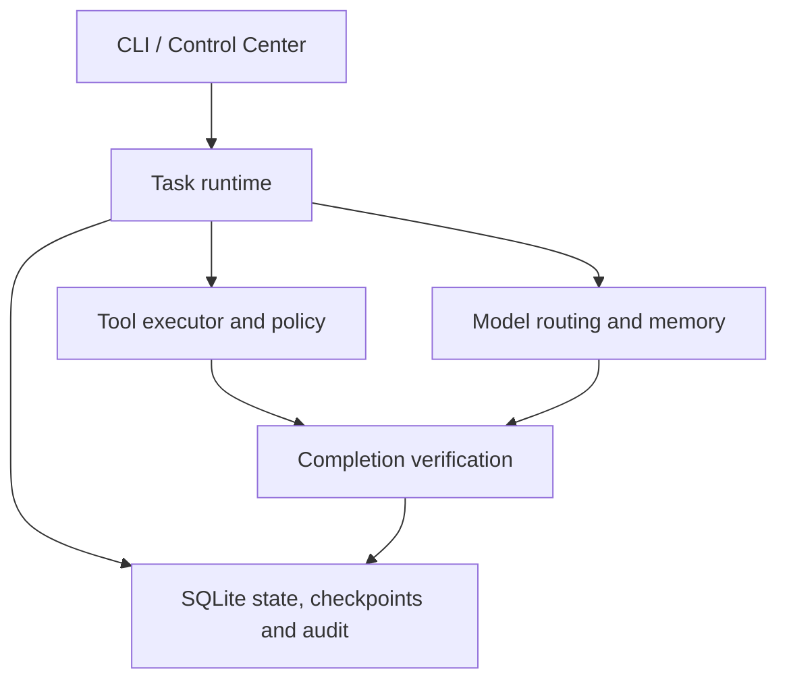

# Beyonder

A TypeScript agent runtime that separates task execution from evidence-based completion, with bounded tool use and persistent execution state.

Experimental software. A completed model response is not proof that a task succeeded.

## Why this exists

Multi-step agents need more than a model API: they need explicit state, permission boundaries, recoverable execution, and a way to reject unsupported success claims. Beyonder explores those problems in a local runtime.

## What it does

- Plans and executes bounded tasks through a tool registry and policy layer.
- Tracks retries, checkpoints, execution leases, and reconciliation requirements.
- Routes model requests across configured providers and records capability and cost observations.
- Checks completion against tool results, required evidence, requested output formats, and optional semantic verification.
- Persists state, memory, audit events, and budgets in SQLite.
- Exposes a CLI and a Next.js Control Center for inspection and operator commands.

## Architecture



The current task executor lives in `packages/runtime/src/tasks/`. It records observed tool outcomes before evaluating completion. The newer mission kernel in `packages/runtime/src/missions/` adds validated plans, scheduling, events, and budget authority; it is a foundation under integration, not a claim that every product flow uses it.

| Component | Code |
| --- | --- |
| Task execution and recovery | `packages/runtime/src/tasks/` |
| Mission kernel | `packages/runtime/src/missions/` |
| Provider discovery and routing | `packages/compute/`, `packages/runtime/src/models/` |
| Tool contracts and policy | `packages/tools/` |
| Browser isolation and SSRF boundaries | `packages/browser-agent/` |
| Memory, budget accounting, audit | `packages/runtime/src/{memory,economy,audit}/` |
| Controlled evaluation fixtures | `packages/web-evals/`, `packages/benchmark/` |
| Operator interface | `apps/dashboard/` |

## Tech stack

TypeScript, Node.js 22+, pnpm workspaces, SQLite, better-sqlite3, Drizzle, Zod, Vitest, Playwright, Next.js and React.

## Engineering highlights

- **Execution and success are separate states.** The objective verifier can reject a finished execution when evidence or requested tool use is missing.
- **Bounded recovery.** Step, retry, replan, time, and cost budgets constrain execution.
- **Persistent accounting.** Spend reservations have unique idempotency keys; tests cover concurrency and crash recovery.
- **Browser boundaries.** URL policy and pinned transport are tested against private-network access, redirects, and DNS rebinding.
- **Controlled evaluation.** Fixture-based tests exercise failure and recovery without treating a live model response as a deterministic test oracle.

## Getting started

```bash
git clone https://github.com/macielhgustavo/beyonder.git
cd beyonder
pnpm install --frozen-lockfile
pnpm build
BEYONDER_MODEL_PROVIDER=none pnpm beyonder status
```

Use Node.js 22 and pnpm 9 for parity with the existing CI. The SQLite native binding must be available; if your installer suppresses dependency build scripts and reports a missing binding, run `npm rebuild better-sqlite3` before building.

Copy `.env.example` to `.env` to configure providers. Start with `BEYONDER_MODEL_PROVIDER=none` for inspection without model calls. This does not demonstrate live autonomous task success.

The Control Center has [its own setup and authentication guide](apps/dashboard/README.md).

## Tests

```bash
pnpm typecheck
pnpm test
pnpm control-center:typecheck
pnpm control-center:test
```

Browser E2E is separate and requires Chromium:

```bash
pnpm --filter @beyonder/browser-agent exec playwright install chromium
pnpm test:browser:e2e
```

Live-provider and public-web smokes depend on credentials, provider availability, and network conditions. Keep those distinct from controlled regression tests.

## Technical decisions

- **SQLite over a remote service:** simpler local operation and transactional accounting; this is not a distributed multi-worker deployment.
- **Explicit tool contracts:** validation and policy enforcement sit outside model prompting.
- **Independent completion checks:** deterministic invariants are useful but cannot establish semantic correctness for every arbitrary task.
- **Incremental kernel migration:** legacy task execution remains while mission contracts are introduced and tested.

## Limitations

- Experimental and under active integration; no claim of production adoption, measured revenue, or general autonomous reliability.
- Live task quality depends on model capability and available tools.
- Policies reduce risk; they do not make arbitrary tool execution a security sandbox.
- Mission action intent/receipt contracts are not proof that all external actions have a complete reconciliation implementation.
- The repository contains parallel legacy and newer modules that still need consolidation.

## Roadmap

- Consolidate task and mission execution without weakening completion checks.
- Maintain reproducible, credential-free product examples.
- Qualify recovery and verification against a small, explicit acceptance corpus.
