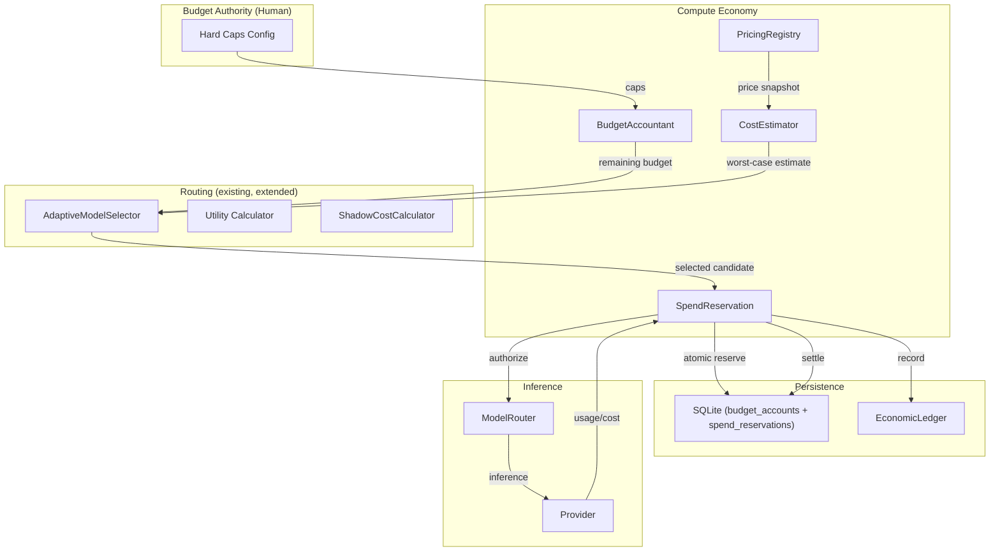
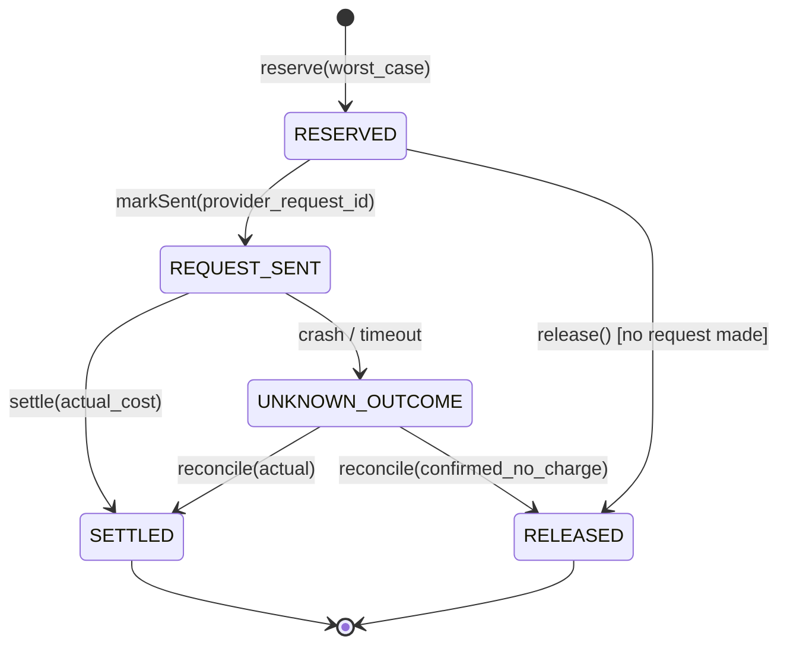
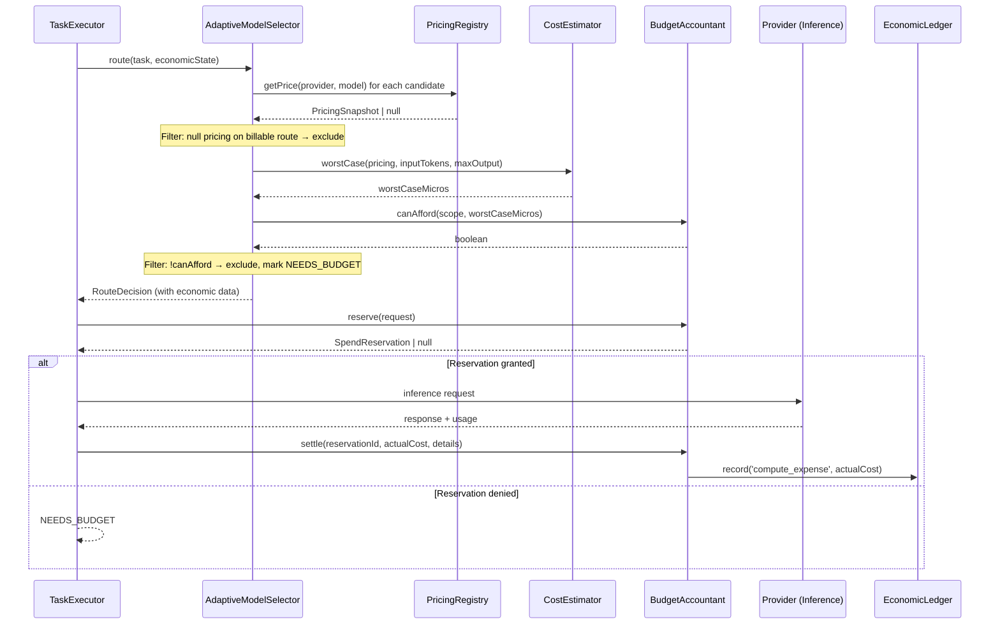
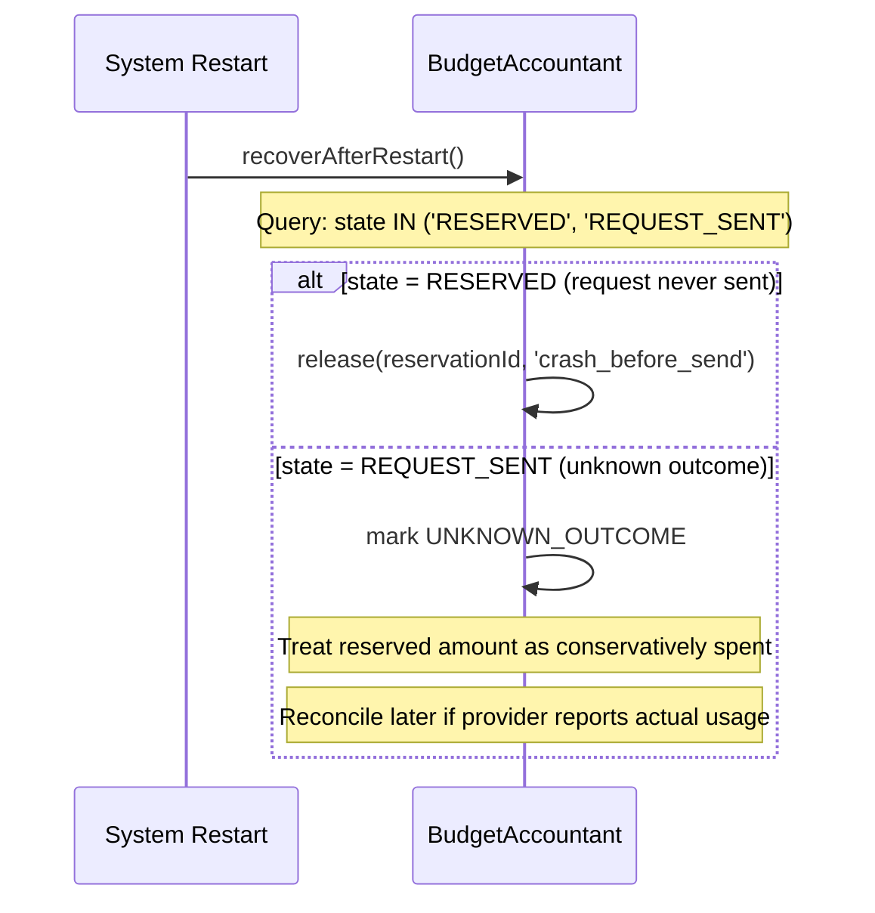

# Beyonder v0.6 — Autonomous Compute Economy Architecture

## Status
**PHASE 3 COMPLETE** — Live Paid Canary Execution (`V06_LIVE_CANARY_READY=true`)
- Phase 1: Economic Foundation Ready (`V06_ECONOMIC_FOUNDATION_READY=true`)
- Phase 2: Shadow Paid Routing & Pricing Discovery Ready (`V06_SHADOW_ROUTING_READY=true`)
- Phase 3: Live Paid Canary Execution Ready (`V06_LIVE_CANARY_READY=true`)
- Phase 4: Full Multi-Provider Economy (Ready for next rollout)

## Base Commit
`6ddea2a` on `origin/main` (stable v0.5 HEAD).

> [!NOTE]
> Remote branches `feat/v05-runtime-hardening-claude` (c73b1c6),
> `feat/v05-final-integration` (1dac0ba), and `feat/v05-cloud-first-routing`
> (aa6e402) contain qualifying v0.5 work not yet merged to main.
> Commits `367cad9` and `6cd471b` referenced in the original spec were **not found**
> in any local or remote branch — they may have been rebased away or exist in
> another clone.  v0.6 is intentionally based on the last stable remote HEAD.
> Those v0.5 branches should be integrated independently after qualification.

---

## 1. Objectives

The Beyonder must evolve from a zero-cost-only agent to an agent that can
**buy compute intelligently** within hard human-authorized limits.

### Goals
1. **Bounded autonomous spending** — spend money on inference, never exceed authorized budgets.
2. **Rational allocation** — choose paid compute only when expected utility justifies cost.
3. **Failure-safe accounting** — crashes, retries and restarts never duplicate spend.
4. **Free-first** — free compute remains a first-class, preferred candidate.
5. **Provider independence** — no provider becomes the default "brain."
6. **Observability** — every spend decision is explainable and auditable.
7. **Zero-cost backward compatibility** — existing v0.5 operation is unaffected by default.

### Non-Goals (this phase)
- Live paid inference execution (Phase 3+)
- Multi-currency / forex (model currency explicitly but only implement USD)
- Provider billing API integration for reconciliation
- Automatic billing enablement or plan upgrades
- Full value-aware routing with historical cost/quality learning (Phase 2+)

---

## 2. Invariants

These are hard invariants that the system MUST enforce at all times.
A violation of any invariant is a critical defect.

| # | Invariant |
|---|-----------|
| **I-1** | Actual spend MUST NEVER exceed an authorized hard budget at any level of the hierarchy. |
| **I-2** | Retries, crashes, and process restarts MUST NOT duplicate reserved or accounted spend. |
| **I-3** | A model/provider cannot be selected if its worst-case authorized request cost exceeds remaining applicable budget. |
| **I-4** | Unknown price on a potentially billable route MUST NOT silently execute. |
| **I-5** | Actual provider-reported cost overrides estimates when available. |
| **I-6** | Free compute remains eligible and competes normally with paid candidates. |
| **I-7** | Paid compute competes based on expected utility, not provider name. |
| **I-8** | Budget exhaustion results in a controlled economic state (NEEDS_BUDGET), not uncontrolled retries. |
| **I-9** | A producer cannot authorize its own additional spending. |
| **I-10** | The agent cannot autonomously increase its own global spending ceiling. |

---

## 3. v0.5 Architecture Audit Summary

### Current Flow
```
OBJECTIVE
  → TaskClassifier (complexity, risk, type)
  → IntelligenceLayer (plan creation)
  → AdaptiveModelSelector.route() or ModelRouter.route()
    → buildComputeInventory() → filter cost="$0" + status healthy/keyless
    → score candidates (quality, shadow cost, reliability, latency)
    → select highest utility
  → completeAutoCandidate() → fetch to provider OpenAI-compat endpoint
  → EvaluationLayer (verify)
  → TaskOutcome → PerformanceRepository.record()
  → EconomicLedger.record() (settlement)
```

### Key Gaps for v0.6
| Area | Current State | v0.6 Requirement |
|------|--------------|-------------------|
| Monetary cost | Hardcoded `0` everywhere | Real pricing, estimation, reservation |
| Budget enforcement | `maxMonetaryCostUsd: 0` in TaskBudget | Hierarchical budget with hard caps |
| Reservation system | None | Atomic reserve → settle → release |
| Price data | None | Per-model pricing snapshots |
| Crash safety | No spend state persistence | Persistent reservation lifecycle |
| Concurrency | No protection | Atomic SQLite transactions |
| Money representation | `real` (float64) in SQLite | Integer microdollars |
| Ledger types | `capital|expense|revenue|adjustment` | + `compute_reservation|compute_settlement|reservation_release` |
| Candidate filtering | `cost !== "$0"` hard gate | Budget-aware economic gate |
| Economic routing policy | `maxMonetaryCostUsd: 0` | Configurable per economic state |

---

## 4. Components



### 4.1 BudgetAccountant
**Responsibility:** Manage the hierarchical budget tree. Answer "is there budget for X?"
atomically. Enforce hard caps.

Location: `packages/runtime/src/economy/budget-accountant.ts`

### 4.2 SpendReservation
**Responsibility:** Manage the reservation lifecycle
(AVAILABLE → RESERVED → SETTLED/RELEASED/UNKNOWN_OUTCOME). Ensure atomicity
via SQLite transactions. Handle crash recovery.

Location: `packages/runtime/src/economy/spend-reservation.ts`

### 4.3 PricingRegistry
**Responsibility:** Store and retrieve per-model per-provider pricing snapshots.
Answer "what does this model cost?" with source, confidence, and freshness.

Location: `packages/runtime/src/economy/pricing-registry.ts`

### 4.4 CostEstimator
**Responsibility:** Estimate worst-case request cost given a model, estimated
input tokens, max output tokens, and pricing snapshot.

Location: `packages/runtime/src/economy/cost-estimator.ts`

---

## 5. Data Model

### 5.1 Money Representation

**Decision (see ADR-005):** Integer microdollars (1 USD = 1,000,000 micros).

```typescript
/** 1 USD = 1_000_000 micros. Integer arithmetic only. */
export type Microdollars = number & { readonly __brand: 'Microdollars' };

export function usdToMicros(usd: number): Microdollars {
  return Math.round(usd * 1_000_000) as Microdollars;
}

export function microsToUsd(micros: Microdollars): number {
  return micros / 1_000_000;
}
```

All internal accounting uses `Microdollars`. USD floats only at API boundaries
(config input, display output).

### 5.2 Budget Hierarchy

```
GLOBAL_HARD_CAP (operator-set, immutable at runtime)
  ├── MONTHLY_HARD_CAP
  │     ├── DAILY_HARD_CAP
  │     │     ├── OBJECTIVE_HARD_CAP
  │     │     │     ├── PRODUCER_ALLOCATION
  │     │     │     ├── VERIFIER_ALLOCATION
  │     │     │     ├── RECOVERY_RESERVE
  │     │     │     └── per-inference reservation
  │     │     └── ...more objectives
  │     └── ...more days
  └── ...more months
```

Each level has:
- `hardCapMicros` — never exceeded (human-set or derived)
- `softTargetMicros` — optimization target
- `spentMicros` — settled actual spend
- `reservedMicros` — outstanding reservations

**Invariant:** `spentMicros + reservedMicros ≤ hardCapMicros` at every level.

### 5.3 Budget Account Schema (SQLite)

```sql
CREATE TABLE budget_accounts (
  id            TEXT PRIMARY KEY,          -- e.g. 'monthly:2026-10', 'daily:2026-10-11', 'objective:<id>'
  kind          TEXT NOT NULL,             -- 'global' | 'monthly' | 'daily' | 'objective' | 'phase'
  parent_id     TEXT,                      -- FK to parent budget_account
  hard_cap      INTEGER NOT NULL,          -- microdollars, immutable once set
  soft_target   INTEGER NOT NULL DEFAULT 0,-- microdollars
  spent         INTEGER NOT NULL DEFAULT 0,-- microdollars, only increases via settlement
  reserved      INTEGER NOT NULL DEFAULT 0,-- microdollars, increases via reservation, decreases via settle/release
  currency      TEXT NOT NULL DEFAULT 'USD',
  created_at    TEXT NOT NULL,
  updated_at    TEXT NOT NULL,
  FOREIGN KEY (parent_id) REFERENCES budget_accounts(id)
);
```

### 5.4 Spend Reservation Schema (SQLite)

```sql
CREATE TABLE spend_reservations (
  id                  TEXT PRIMARY KEY,       -- nanoid
  budget_account_id   TEXT NOT NULL,          -- FK to budget_accounts
  task_id             TEXT,                   -- objective/task context
  phase               TEXT,                   -- 'producer' | 'verifier' | 'recovery' | 'adjudication'
  provider            TEXT NOT NULL,
  model               TEXT NOT NULL,
  estimated_input_tokens  INTEGER,
  max_output_tokens       INTEGER,
  worst_case_cost     INTEGER NOT NULL,       -- microdollars, reserved amount
  actual_cost         INTEGER,                -- microdollars, set on settlement
  pricing_snapshot_id TEXT,                    -- FK to pricing snapshots used
  state               TEXT NOT NULL DEFAULT 'RESERVED',
    -- RESERVED | REQUEST_SENT | SETTLED | RELEASED | UNKNOWN_OUTCOME
  idempotency_key     TEXT NOT NULL UNIQUE,   -- prevent duplicate reservations
  provider_request_id TEXT,                   -- external correlation
  created_at          TEXT NOT NULL,
  sent_at             TEXT,                   -- when request was dispatched
  settled_at          TEXT,
  error               TEXT,
  FOREIGN KEY (budget_account_id) REFERENCES budget_accounts(id)
);
```

### 5.5 Pricing Snapshot Schema (SQLite)

```sql
CREATE TABLE pricing_snapshots (
  id                TEXT PRIMARY KEY,
  provider          TEXT NOT NULL,
  model             TEXT NOT NULL,
  currency          TEXT NOT NULL DEFAULT 'USD',
  input_per_million INTEGER NOT NULL,         -- microdollars per 1M input tokens
  output_per_million INTEGER NOT NULL,        -- microdollars per 1M output tokens
  cache_read_per_million  INTEGER DEFAULT 0,
  cache_write_per_million INTEGER DEFAULT 0,
  request_fee       INTEGER DEFAULT 0,        -- fixed per-request fee in microdollars
  source            TEXT NOT NULL,             -- 'provider_api' | 'static_metadata' | 'openrouter_api'
  confidence        TEXT NOT NULL DEFAULT 'medium', -- 'high' | 'medium' | 'low'
  effective_at      TEXT NOT NULL,
  fetched_at        TEXT NOT NULL,
  UNIQUE(provider, model, effective_at)
);
```

### 5.6 Reservation State Machine



---

## 6. Key Interfaces

```typescript
/** Budget authorization check — atomic, reads current state. */
interface BudgetAccountant {
  /** Can we afford worst-case cost at all applicable budget levels? */
  canAfford(scope: BudgetScope, worstCaseMicros: Microdollars): Promise<boolean>;

  /** Reserve budget atomically across all applicable levels. Returns reservation or null. */
  reserve(params: ReservationRequest): Promise<SpendReservation | null>;

  /** Settle a reservation with actual cost. Releases unused budget. */
  settle(reservationId: string, actualCostMicros: Microdollars, details: SettlementDetails): Promise<void>;

  /** Release a reservation entirely (no request was made). */
  release(reservationId: string, reason: string): Promise<void>;

  /** Get remaining available budget (hard_cap - spent - reserved) at a scope. */
  available(scope: BudgetScope): Promise<Microdollars>;

  /** Recover reservations left in RESERVED or REQUEST_SENT state after crash. */
  recoverAfterRestart(): Promise<RecoveryReport>;
}

interface BudgetScope {
  objectiveId?: string;
  phase?: 'producer' | 'verifier' | 'recovery' | 'adjudication';
}

interface ReservationRequest {
  scope: BudgetScope;
  provider: string;
  model: string;
  worstCaseMicros: Microdollars;
  estimatedInputTokens: number;
  maxOutputTokens: number;
  pricingSnapshotId: string;
  idempotencyKey: string;
  taskId?: string;
}

interface SettlementDetails {
  actualInputTokens?: number;
  actualOutputTokens?: number;
  providerReportedCostUsd?: number;
  providerRequestId?: string;
}

interface PricingRegistry {
  /** Get best known pricing for a model. Returns null if unknown. */
  getPrice(provider: string, model: string): Promise<PricingSnapshot | null>;

  /** Record/update a pricing snapshot. */
  recordPrice(snapshot: PricingSnapshot): Promise<void>;

  /** Is the pricing fresh enough to trust? */
  isFresh(snapshot: PricingSnapshot, maxAgeSec?: number): boolean;
}

interface CostEstimator {
  /** Estimate worst-case cost for an inference request. */
  worstCase(params: {
    pricing: PricingSnapshot;
    estimatedInputTokens: number;
    maxOutputTokens: number;
  }): Microdollars;
}
```

---

## 7. Compute Modes

```typescript
type ComputeMode = 'zero_cost' | 'bounded' | 'manual_approval';
```

| Mode | Behavior |
|------|----------|
| `zero_cost` | v0.5 behavior. Only free/keyless providers. `monetaryCostUsd` stays 0. |
| `bounded` | Paid compute allowed within hard caps. Autonomous allocation decisions. |
| `manual_approval` | Paid routes require explicit human approval per objective. |

**Default after migration: `zero_cost`.**
Paid compute NEVER activates without explicit operator configuration.

---

## 8. Configuration

```typescript
// Minimal operator config
interface ComputeEconomyConfig {
  mode: ComputeMode;                    // default: 'zero_cost'
  monthlyHardCapUsd?: number;           // default: 0
  dailyHardCapUsd?: number;             // default: monthlyHardCap / 30
  defaultObjectiveHardCapUsd?: number;  // default: 0.25
  defaultObjectiveSoftTargetUsd?: number; // default: 0.03
  maxSingleInferenceUsd?: number;       // default: 0.10
}
```

Environment variables:
```
BEYONDER_COMPUTE_MODE=zero_cost         # zero_cost | bounded | manual_approval
BEYONDER_MONTHLY_HARD_CAP_USD=0         # 0 = zero_cost enforced
BEYONDER_DAILY_HARD_CAP_USD=0
BEYONDER_OBJECTIVE_HARD_CAP_USD=0.25
BEYONDER_OBJECTIVE_SOFT_TARGET_USD=0.03
BEYONDER_MAX_INFERENCE_USD=0.10
```

---

## 9. Operational Flows

### 9.1 Inference with Budget Check



### 9.2 Crash Recovery



---

## 10. Failure Modes

| Failure | Impact | Mitigation |
|---------|--------|------------|
| Process crash after reservation, before send | Budget leak (orphaned reservation) | Recovery: release on restart |
| Process crash after send, before settle | Unknown spend | Recovery: mark UNKNOWN_OUTCOME, conservative accounting |
| Concurrent reservations exceed budget | Over-spend | Atomic SQLite transaction with `spent + reserved + new ≤ cap` check |
| Provider returns unexpected cost | Budget violation | Settle with actual; if actual > reserved → economic incident, circuit break |
| Pricing data stale | Cost underestimate | Freshness check; block if stale beyond threshold |
| Provider silently upgrades model | Unexpected billing | Request-level model pinning; max_price where supported |
| SQLite corruption | Lost accounting state | WAL mode; backup; conservative halt on integrity failure |
| Infinite retry loop | Budget drain | Hard cap + max retries + NEEDS_BUDGET state |

---

## 11. Concurrency Model

SQLite in WAL mode with `BEGIN IMMEDIATE` transactions for all budget mutations.

**Reserve operation pseudocode:**
```sql
BEGIN IMMEDIATE;
  -- Read all applicable accounts (objective, daily, monthly, global)
  -- For each: verify (hard_cap - spent - reserved) >= worst_case
  -- If any fails: ROLLBACK, return null
  -- For each: UPDATE reserved = reserved + worst_case
  -- INSERT spend_reservation
COMMIT;
```

This guarantees that concurrent reserve attempts are serialized by SQLite's
write lock. At most one succeeds when budget is tight.

---

## 12. Security Model

### 12.1 Budget Authority Separation

```
HUMAN OPERATOR (external)
  │
  ├── Sets hard caps via config/env
  ├── Enables compute mode
  └── Cannot be overridden by runtime

BEYONDER RUNTIME (internal)
  │
  ├── Allocates within authorized caps
  ├── Decides which model to use
  └── Cannot increase caps
```

### 12.2 Threat Mitigations

| Threat | Mitigation |
|--------|------------|
| Prompt injection requesting budget increase | Hard caps read from config at startup, immutable at runtime. Model output has no authority over budget. |
| Malicious tool triggering expensive inference | Tool execution cannot invoke inference directly. Budget check is in the routing layer. |
| Provider misreporting usage | Compare actual vs estimate. Circuit break on repeated discrepancy. |
| Retry storm | `maxRetries` in TaskBudget + reservation cost accumulates against budget. |
| Concurrency race | Atomic SQLite transactions (see §11). |
| Compromised model changing budget | Budget accounts are write-protected; only `BudgetAccountant` can mutate via typed API. |
| Infinite adjudication/revision | Phase budget allocations (verifier, recovery) cap spend per phase. |

---

## 13. Observability

Every spend decision produces structured telemetry:

```typescript
interface SpendDecisionRecord {
  objectiveId: string;
  taskId: string;
  provider: string;
  model: string;
  phase: string;
  pricingSnapshotId: string;
  estimatedCostMicros: number;
  worstCaseCostMicros: number;
  actualCostMicros: number | null;
  budgetRemainingMicros: number;
  budgetHardCapMicros: number;
  freeAlternativesConsidered: number;
  paidAlternativesConsidered: number;
  whySelected: string;
  whyNotFree: string[];
  expectedUtility: number;
  reservationId: string;
  reservationState: string;
  timestamp: string;
}
```

---

## 14. Migration: v0.5 → v0.6

### Phase 1: Non-breaking additions
1. Add new SQLite tables (`budget_accounts`, `spend_reservations`, `pricing_snapshots`)
2. Add `ComputeEconomyConfig` to env schema with safe defaults
3. `BudgetAccountant` initialized but dormant when `mode = 'zero_cost'`
4. All existing `monetaryCostUsd: 0` paths unchanged

### Phase 2: Shadow routing (COMPLETED)
1. `PricingRegistry` populated with SQLite persistence and seed catalogue pricing (`catalog-pricing.ts`)
2. `PriceFetcher` parses dynamic provider rates (e.g. OpenRouter `/api/v1/models`) into microdollars
3. `CostEstimator` computes worst-case and expected costs prior to selection
4. Router evaluates paid candidates in shadow mode (`RouteDecision.shadowDecision`, actual spend strictly $0.00)
5. Invariants I-3 (budget ceiling) and I-4 (unknown price blocks billable route) strictly enforced
6. `SpendDecisionRecord` and `ShadowReportGenerator` produce structured explainability and multi-task reports
7. Full 15-scenario acceptance test suite verified (`V06_SHADOW_ROUTING_READY=true`)

### Phase 3: Live canary (COMPLETED)
1. Operator sets `mode: 'bounded'`, tiny hard cap ($\le \$0.01$)
2. Router can select paid candidate (`PAID_CLOUD` eligible in bounded live mode)
3. Two-Phase Spend-Commit pipeline active in `runCandidates` (reserve $\rightarrow$ markSent $\rightarrow$ settle/release)
4. Multi-layer canary guardrails: single canary provider pinning (`openrouter`), idempotency key per attempt, economic circuit breaker
5. Zero-cost mode preserves 100% strict $0.00 spend invariant
6. Full acceptance test suite verified (`live-canary.test.ts`, 12 scenarios passing)
7. ADR-008 recorded (`V06_LIVE_CANARY_READY=true`)

### Phase 4: Full economy
1. Multiple providers with pricing
2. Value-aware routing
3. Phase budget allocation
4. Cost/quality learning

---

## 15. Testing Strategy

| Level | Scope | Key Scenarios |
|-------|-------|---------------|
| **Unit** | Money arithmetic | Microdollar conversion, rounding, overflow |
| **Unit** | CostEstimator | Worst-case calculation, edge cases |
| **Unit** | PricingRegistry | Freshness, unknown pricing blocks |
| **Integration** | BudgetAccountant | Reserve → settle → verify balances |
| **Integration** | Crash recovery | Kill after each state transition, verify recovery |
| **Concurrency** | Atomic reservations | 100 concurrent reserves for remaining $0.10, verify ≤ 10 succeed |
| **Property** | Budget invariants | For any sequence of operations: spent ≤ hardCap, available ≥ 0 |
| **Regression** | Zero-cost mode | All v0.5 tests pass with economy layer present but dormant |
| **Acceptance** | 15 scenarios from spec | Budget exhaustion, concurrent reserve, crash recovery, etc. |

---

## 16. Phased Rollout

| Phase | Deliverable | Spend |
|-------|------------|-------|
| **A** | Architecture + persistence + budgets + reservations + crash recovery | $0 |
| **B** | Shadow paid routing + pricing snapshots + cost estimates | $0 |
| **C** | One paid provider canary (operator-enabled, tiny cap) | ≤ $0.01 |
| **D** | Multi-provider competition + failover | bounded |
| **E** | Value-aware allocation + cost/quality learning | bounded |

---

## Appendix: File Layout

```
packages/runtime/src/economy/
  ├── money.ts                    # Microdollars type, conversion, arithmetic
  ├── budget-accountant.ts        # Budget hierarchy, reservation, settlement
  ├── spend-reservation.ts        # Reservation lifecycle, crash recovery
  ├── pricing-registry.ts         # Pricing snapshots, freshness
  ├── cost-estimator.ts           # Worst-case cost calculation
  ├── compute-economy-config.ts   # Config types, defaults, validation
  ├── economic-state.ts           # (existing, extended)
  ├── ledger.ts                   # (existing, extended with compute entries)
  └── __tests__/
      ├── money.test.ts
      ├── budget-accountant.test.ts
      ├── spend-reservation.test.ts
      ├── pricing-registry.test.ts
      ├── cost-estimator.test.ts
      └── budget-concurrency.test.ts
```
